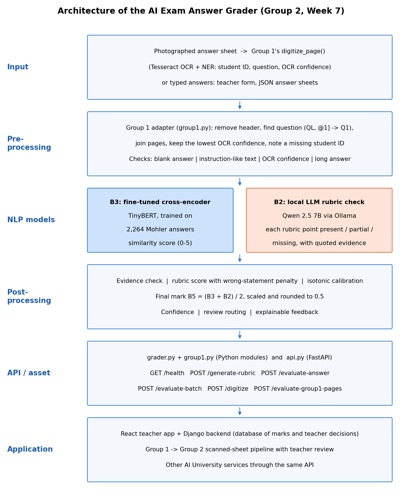

# AI Exam Answer Grader

**A reusable NLP asset that recommends a mark, feedback and a confidence score for a student's descriptive exam answer.** It compares the answer with the teacher's reference answer and a marking rubric, and sends uncertain answers to a teacher. The mark is advisory: a teacher always makes the final decision.

SNLP Course Project 2026, AI University, Group 2: E008 Ritwik Shetty, E009 Chaitanya Thakur, E010 Dhruvit Thakkar, E011 Ajinkya Hatle, E012 Bharat Baswan.



## What it does

Input: a question, a reference answer, an optional rubric, the student's answer and the maximum marks. This can also be a scanned answer sheet read by Group 1's Handwritten Exam Digitizer.

Output (JSON):

```json
{
  "question": "Q1",
  "score": 4.5,
  "maximum_score": 5,
  "feedback": "Only partly covered: It depends on the height of the tree. | ...",
  "confidence": 0.90,
  "needs_human_review": false,
  "review_reasons": [],
  "concepts": [{"concept": "It depends on the height of the tree.", "status": "partial", "evidence": "log n"}],
  "wrong_statements": [],
  "scores_out_of_5": {"similarity_model": 4.67, "llm": 2.5, "rubric": 2.5, "llm_calibrated": 4.41, "final": 4.54}
}
```

How a mark is made:
1. **Similarity model (B3):** a TinyBERT cross-encoder fine-tuned on teacher marks.
2. **Local LLM (B2):** Qwen 2.5 7B, run through Ollama, checks every rubric point. It must quote the student's own words as evidence, and the code verifies each quote.
3. **Final mark:** our code computes the rubric score, calibrates it to the teachers' scale with isotonic regression, and averages it with the similarity model.
4. **Confidence:** the estimated chance that the mark is within ±1 mark of a teacher's. It comes from how much the two models agree.
5. **Review rules:** answers with low confidence, instruction-like text (prompt injection), low OCR confidence or a very long answer are flagged for a teacher.

## Results (honest summary)

Evaluated on 450 Mohler answers to questions the models had never seen (5-fold cross-validation grouped by question), weighted to represent all 2,254 answers. Values are mean ± SD over the folds.

| Method | MAE (marks out of 5) | Within ±1 | Pearson r |
|---|---|---|---|
| Mean predictor (floor) | 0.889 ± 0.054 | 79.7% | – |
| TF-IDF baseline (calibrated) | 0.724 ± 0.139 | 69.6% | 0.46 |
| B3 fine-tuned cross-encoder | 0.684 ± 0.164 | 74.6% | 0.53 |
| B2 v2 LLM rubric grader | **0.553 ± 0.061** | 83.5% | 0.71 |
| **B5 v2 final grader (B3 + B2)** | 0.572 ± 0.107 | 81.9% | **0.71** |

- **Better than the similarity model alone:** the final grader is significantly better than B3 (gain 0.110 marks, 95% CI 0.048 to 0.175). The Week 6 fixes added only a small, non-significant gain over Week 5.
- **Compared with humans:** two human teachers differ by 0.72 marks on average.
- **Review routing:** the rules send 18.8% of answers to a teacher and catch 45.7% of the large errors.
- **Group 1's handwritten data (Week 7):** at their neat-handwriting OCR error rate (CER 0.04) our error rises only from 0.57 to 0.66 marks. At their cursive rate (CER 0.34) it rises to 1.34 marks. Such pages are flagged by their low OCR confidence.
- **Known failures:**
  - A wrong answer that uses the right words, such as "first in last out" for a queue, gets about 3 out of 5.
  - Marks for long answers from a new course are too generous until the grader is recalibrated on that course.

Full details are in [docs/reports](docs/reports).

## Repository structure

```
README.md              this file
requirements.txt       Python packages
src/                   the reusable asset
  grader.py            grading module: evaluate_answer(), evaluate_group1_record(), make_rubric()
  group1.py            adapter for Group 1's Handwritten Exam Digitizer (pages -> answers)
  api.py               FastAPI web service (6 endpoints, documentation at /docs)
models/                fine-tuned cross-encoder, calibration, confidence model, rubric cache, settings
data/                  sample exam in Group 1's format, Group 1 upload example, answer key for Group 1's pages
web/                   deployable teacher application
  backend/             Django: saves graded answers and teacher decisions (SQLite), review queue API, serves the React app
  frontend/            React (Vite + Recharts) teacher interface
demo/                  earlier Streamlit prototype (Week 6)
notebooks/             Week 6 (models, evaluation, API tests) and Week 7 (Group 1 integration, OCR experiment)
results/               evaluation tables and charts (Weeks 6 and 7)
tests/                 automated tests (pytest)
docs/                  architecture diagram and the weekly reports
```

The notebooks run from the repository root. They read the earlier weeks' results from the course folders `../Week 3-4` and `../Week 5`, which sit next to this repository in the submission. The Week 1–5 notebooks are in those course folders.

## How to run it

**Requirements:**
- macOS or Linux with Python 3.10, plus [Ollama](https://ollama.com) for the local LLM.
- Node.js only if you rebuild the React app.
- Tesseract only for Group 1's digitizer.

```bash
pip install -r requirements.txt
ollama pull qwen2.5:7b-instruct
```

**1. The local LLM:** open the Ollama app, or run `ollama serve`.

**2. The grading service (API):**

```bash
cd src
uvicorn api:app --port 8000
```

Interactive API documentation: http://localhost:8000/docs

**3. The teacher web application:**

```bash
cd web/backend
python manage.py migrate
python manage.py runserver 8001
```

Open http://localhost:8001. The built React app is already in `web/frontend/dist`. To change the frontend, run `npm install` and `npm run build` in `web/frontend`, or run `npm run dev` for live editing at http://localhost:5173.

**Optional: Group 1's digitizer.** Put Group 1's project next to this repository as `../Group 1 digitizer`, or set `GROUP1_DIGITIZER_PATH`. Then install Tesseract (`brew install tesseract`). The "Scanned sheets" page and `POST /digitize` then read photographed answer sheets.

**Tests:**

```bash
pytest tests
cd web/backend && python manage.py test grading
```

They do not need the LLM: 23 tests for the grader, the Group 1 adapter and the API, and 5 for the web app's teacher reviews.

## Use it from another application

| Endpoint | What it does |
|---|---|
| `GET /health` | Is the service ready? Are the LLM and Group 1's digitizer available? |
| `POST /generate-rubric` | Makes rubric key points from a reference answer for a teacher to check |
| `POST /evaluate-answer` | Grades one answer |
| `POST /evaluate-batch` | Grades answers in the course handout's Group 1 format (`student_id, question, answer_text, page, confidence`) |
| `POST /digitize` | Reads one scanned page with Group 1's `digitize_page()` |
| `POST /evaluate-group1-pages` | Grades Group 1's page records exactly as their digitizer returns them |

```python
import requests

request_body = {
    "question_text": "What is a queue?",
    "reference_answer": "A data structure that stores elements following the first in first out principle.",
    "student_answer": "A list where the first item added is the first one removed (FIFO).",
    "maximum_marks": 5,
}
reply = requests.post("http://localhost:8000/evaluate-answer", json=request_body)
print(reply.json()["score"], reply.json()["confidence"], reply.json()["needs_human_review"])
```

Group 1 → Group 2:

```python
from digitizer import digitize_page

page = digitize_page("answer sheet page 1.jpg", page_number=1)
reply = requests.post("http://localhost:8000/evaluate-group1-pages",
                      json={"answer_key": answer_key, "pages": [page], "student_id": "E007"})
```

You can also import the module directly:

```python
import grader

grader.evaluate_answer(question_text, reference_answer, student_answer, maximum_marks=5)
```

## Data

- **Source:** the Mohler short-answer grading dataset (Kaggle mirror `abdokamr/mohler`). Answers to data-structures and C++ questions from a university computer science course, each marked 0–5 by two teachers. Our label is the average of the two marks.
- **Size and cleaning:** 2,273 answers. 9 answers stored as "#NAME?" (a spreadsheet error) were removed, leaving 2,264 answers to 79 questions.
- **Limitations:**
  - Marks are skewed high (mean 4.17 out of 5).
  - The data comes from one course in English, and answers are short (95% have 45 words or fewer).
  - The two teachers differ by 2 marks or more on 18% of answers.
- **Group 1 data:** two real answer sheets with hand-typed true text, from Group 1's repository (no teacher marks).

## Responsible AI

- **Privacy:** everything runs on the local machine. The LLM is local, so no answer text is sent to an external AI service.
- **Human oversight:** every mark is a recommendation. Flagged answers wait in a review queue, and the teacher's mark and comment are stored.
- **Hallucination:** every rubric point must be supported by the student's own words, and the code checks this.
- **Bias:** the LLM takes marks off for spelling mistakes, and OCR errors depend on handwriting. Low OCR confidence always sends an answer to a teacher, who can correct the text before grading.
- **Security:** prompt-injection patterns are flagged, and the answer text is isolated in the prompt.

## Limitations and future work

- Evaluated on one public dataset and a 450-answer sample. Marks for a new course need recalibration on a few teacher-marked answers.
- The calibration floor (about 2.8) lets wrong answers on the right topic score about 3 out of 5.
- The confidence score is only moderately sharp (AUC 0.62).
- The 7-billion-parameter LLM takes 6–8 seconds per answer.
- The web application has no teacher login yet.
- Next steps:
  - test on anonymised answers from our own class;
  - weighted rubric points;
  - a stronger rule for wrong statements;
  - teacher logins;
  - a larger model on a college server.

## Team

| Member | Part |
|---|---|
| E008 Ritwik Shetty | Problem, data and baseline (TF-IDF, metrics, mean-predictor floor) |
| E010 Dhruvit Thakkar | Improved similarity models (embeddings, cross-encoder, fine-tuning, grouped cross-validation) |
| E011 Ajinkya Hatle | LLM rubric grader (local LLM, evidence check, rubric score, calibration, final ensemble) |
| E012 Bharat Baswan | Evaluation, error analysis and safety (sampling, robustness, prompt injection, confidence, review rules) |
| E009 Chaitanya Thakur | API, teacher interface and integration (FastAPI, Django + React app, Group 1 adapter) |
